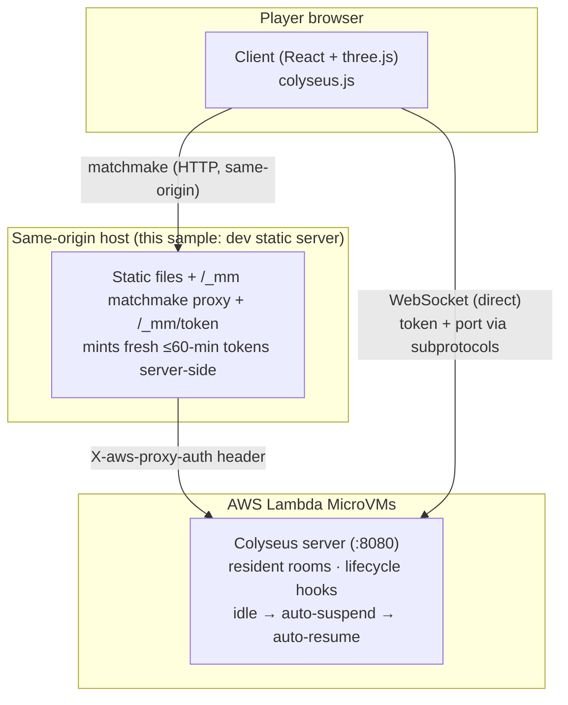

# Host a Colyseus multiplayer game server on AWS Lambda MicroVMs

English | [简体中文](README.zh-CN.md)

This sample shows how to run a **stateful, long-lived, WebSocket-based
multiplayer game server** ([Colyseus](https://colyseus.io/)) on an **[AWS Lambda
MicroVM](https://aws.amazon.com/blogs/aws/)** — a Firecracker-backed sandbox
that keeps a process resident for up to 8 hours, auto-suspends when idle, and
resumes in near-seconds on the next request.

Traditional Lambda functions are request/response and stateless, so realtime
game servers (persistent rooms, server-authoritative tick loops, long-lived
WebSocket connections) have historically needed an always-on EC2/container.
MicroVMs close that gap: **you get an on-demand, resident server that costs
almost nothing while nobody is playing.**

The included game is a small low-poly multiplayer ARPG built with React +
[`@react-three/fiber`](https://r3f.docs.pmnd.rs/). **All 3D content is
procedurally generated geometry** — the sample ships with no external art
assets, so the whole thing is MIT-0.

> ℹ️ Lambda MicroVMs is ARM64-only and available in a subset of regions
> (`us-east-1`, `us-east-2`, `us-west-2`, `eu-west-1`, `ap-northeast-1`). This
> sample defaults to `us-west-2`.

---

## Architecture



Two connection legs, because the browser can't attach the MicroVM's required
`X-aws-proxy-auth` header to every kind of request:

- **Matchmake (HTTP)** is proxied **same-origin** through `/_mm/*`. A browser
  `fetch` straight to the MicroVM endpoint is cross-origin and triggers a CORS
  *preflight* the endpoint rejects (preflight can't carry the auth header), so
  the proxy injects the header server-side.
- **WebSocket** connects **directly** to the MicroVM endpoint (no CORS
  preflight). The browser can't set WS headers, so the auth token and target
  port ride as **subprotocols** (`lambda-microvms.authentication.<token>` and
  `lambda-microvms.port.8080`) — a mechanism AWS provides for exactly this case.

Auth tokens are short-lived (≤60 min) and **minted fresh per connection at
runtime** — never baked into the build. See [docs/architecture.md](docs/architecture.md)
for the full mechanism and gotchas.

### What runs where — the local server is NOT a game server

**The game server runs entirely on the Lambda MicroVM.** All rooms, the
server-authoritative tick loop, game state, and every in-game WebSocket message
live in the MicroVM — nothing game-related executes on your machine.

The local server (`npm run static`) is only a thin **launcher/doorman** that
exists because a browser can't do two things by itself:

| Job | Why it can't live in the browser |
|---|---|
| Serve `client/dist` at an origin | The `/_mm` proxy must be **same-origin** with the page |
| Mint auth tokens (`/_mm/token`) | Requires **AWS credentials**, which must never ship to a browser |
| Proxy matchmake (`/_mm/*`) | The `X-aws-proxy-auth` header can't survive a CORS preflight |

Once the WebSocket is open, **gameplay traffic flows browser ↔ MicroVM
directly** — the local server carries zero in-game traffic and could crash
mid-match without affecting play (until the next matchmake or token refresh).
This split is why the sample needs `npm run static` running locally: it stands
in for what would be API Gateway / CloudFront + a small Lambda in production
(see [Production notes](#production-notes)).

---

## Repository layout

```
.
├── client/      Browser game (React + three.js). Asset-free, procedural geometry.
├── server/      Standalone Colyseus server. Runs inside one MicroVM (:8080).
├── deploy/      CLI: build MicroVM image → run instance → mint tokens / terminate.
├── scripts/     dev-static-server.mjs — static host + matchmake proxy + token endpoint.
└── docs/        Architecture deep-dive.
```

---

## Prerequisites

- **Node.js 20+** and **npm**
- **AWS credentials** in your environment (profile or env vars) in a MicroVM
  region, with permission for `lambda-microvms:*`, `s3:*` on the artifact
  bucket, `iam:*` on the build role, and `sts:GetCallerIdentity`.
- **`zip`** on your PATH (the deploy CLI zips the server build context).
- Docker is **not** required locally — the image is built server-side by
  `CreateMicrovmImage` from `server/Dockerfile`.

---

## Quick start

### 1. Install

```bash
npm run install:all
```

### 2. Run the pieces locally

```bash
# The Colyseus server on :8080 (room "game"). Useful for iterating on game logic.
npm run dev:server

# The client (Vite dev server). The game UI and single-player render offline;
# if no MicroVM is deployed yet, the connection bootstrap fails gracefully.
npm run dev:client
```

The client always reaches the server through the same-origin MicroVM proxy
(`/_mm`), so **multiplayer requires the deployed path below** (deploy → build →
`npm run static`). Use `dev:server` on its own to iterate on room logic and to
smoke-test matchmake with `curl http://localhost:8080/health`.

### 3. Deploy the server to a Lambda MicroVM

```bash
# Build the MicroVM image from server/, run an instance, write config.json.
npm run deploy
```

This runs `deploy/src/cli.ts deploy`, which:

1. ensures an S3 artifact bucket + an IAM build role exist,
2. zips and uploads `server/`,
3. calls **`CreateMicrovmImage`** (server-side Docker build, ~1–2 min),
4. calls **`RunMicrovm`** with an idle-suspend policy, waits for `RUNNING`,
5. writes `client/public/config.json` + `.microvm-deploy.json` with
   `{ endpoint, microvmId, region }` (**no token** — minted at runtime).

### 4. Serve the deployed game

```bash
npm run build:client     # builds client/dist (config.json comes along)
npm run static           # http://localhost:3000 — static host + /_mm proxy + /_mm/token
```

Open `http://localhost:3000`. The browser fetches a fresh token from
`/_mm/token`, matchmakes through the same-origin proxy, then opens a WebSocket
**directly** to the MicroVM. Open it in two tabs to see multiplayer.

> ℹ️ `npm run static` is a launcher, not a game server: it serves the static
> files and brokers tokens/matchmake. All rooms and gameplay run in the
> MicroVM, and in-game traffic goes browser ↔ MicroVM directly — see
> [What runs where](#what-runs-where--the-local-server-is-not-a-game-server).

### 5. Inspect / tear down

```bash
npm --prefix deploy run info       # state + live endpoint
npm --prefix deploy run token      # mint a token (debugging)
npm --prefix deploy run terminate  # terminate the instance (stops billing)
```

---

## Cost model

Billing follows **duty cycle**, not wall-clock ownership:

- **Running** — billed per second while serving.
- **Idle → suspended** — after `maxIdleDurationSeconds` (30 min here) the
  instance snapshots and you pay only a small snapshot-storage fee; inbound
  traffic auto-resumes it.
- **Terminated** — zero cost.

This is ideal for **long-tail** games (mostly idle, occasionally woken). For a
sustained high-concurrency game, an always-on instance may be cheaper — pick
the instance size by expected room population (bandwidth scales linearly with
size and is shared in+out).

> Always clean up with `terminate` when you're done to stop billing.

---

## Production notes

This repo's `dev-static-server.mjs` is a **local reference** for the
same-origin proxy + token mechanism. For production:

- Front the matchmake proxy + token endpoint with **API Gateway** or an
  **ALB + CloudFront** — **not** a raw Lambda Function URL.
- Handle the **8-hour max** instance lifetime (rotate/restart long-lived rooms).
- On **suspend/resume**, active WebSockets drop — use the lifecycle hooks plus
  client reconnect (the server already acknowledges the hooks; the client
  reconnect logic is left as an exercise).
- Refresh tokens for matches longer than 60 minutes.

---

## License

This sample is licensed under **MIT-0**. See [LICENSE](LICENSE). All 3D content
is procedurally generated in code; see [NOTICE.md](NOTICE.md).
