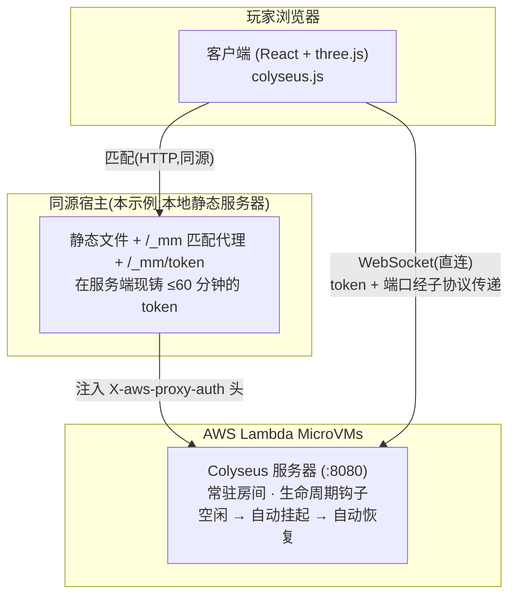

# 在 AWS Lambda MicroVMs 上托管 Colyseus 多人游戏服务器

[English](README.md) | 简体中文

本示例演示如何将一个**有状态、长驻、基于 WebSocket 的多人游戏服务器**
([Colyseus](https://colyseus.io/)) 运行在 **[AWS Lambda
MicroVM](https://aws.amazon.com/blogs/aws/)** 上 —— 一种基于 Firecracker 的沙箱,
进程最长可驻留 8 小时,空闲时自动挂起(suspend),下一个请求到来时近秒级恢复。

传统 Lambda 函数是请求/响应式、无状态的,因此实时游戏服务器(持久房间、
服务端权威 tick 循环、长连接 WebSocket)历来只能依赖常驻的 EC2/容器。
MicroVM 补上了这个缺口:**你得到一个按需启动的常驻服务器,没人玩的时候
几乎不产生费用。**

内置的游戏是一个用 React + [`@react-three/fiber`](https://r3f.docs.pmnd.rs/)
构建的低多边形多人 ARPG。**所有 3D 内容均为程序化生成的几何体** ——
示例不含任何外部美术资源,因此整个项目采用 MIT-0 许可。

> ℹ️ Lambda MicroVMs 仅支持 ARM64,且只在部分区域可用
> (`us-east-1`、`us-east-2`、`us-west-2`、`eu-west-1`、`ap-northeast-1`)。
> 本示例默认使用 `us-west-2`。

---

## 架构



连接分为两条腿,因为浏览器无法在所有类型的请求上附加 MicroVM 要求的
`X-aws-proxy-auth` 头:

- **匹配(HTTP)** 经 `/_mm/*` 做**同源**代理。浏览器直接 `fetch` MicroVM
  endpoint 属于跨域请求,会触发 CORS *预检(preflight)*,而预检无法携带
  auth 头,endpoint 会拒绝它 —— 所以由代理在服务端注入该头。
- **WebSocket 直连** MicroVM endpoint(WS 没有 CORS 预检)。浏览器无法为
  WS 设置自定义头,因此 auth token 和目标端口以**子协议(subprotocol)**的
  形式传递(`lambda-microvms.authentication.<token>` 和
  `lambda-microvms.port.8080`)—— 这是 AWS 专为此场景提供的机制。

Auth token 是短时效的(≤60 分钟),且**每次连接时在运行时现铸** ——
绝不打进构建产物。完整机制与注意事项见
[docs/architecture.md](docs/architecture.md)。

### 职责划分 —— 本地服务器不是游戏服务器

**游戏服务器完全运行在 Lambda MicroVM 上。** 所有房间、服务端权威 tick
循环、游戏状态以及每一条游戏内 WebSocket 消息都在 MicroVM 里 ——
你的本机不执行任何游戏逻辑。

本地服务器(`npm run static`)只是一个轻量的**启动器/门卫**,它存在的原因
是浏览器自身做不了这几件事:

| 职责 | 为什么不能放在浏览器里 |
|---|---|
| 在一个 origin 下托管 `client/dist` | `/_mm` 代理必须与页面**同源** |
| 铸造 auth token(`/_mm/token`) | 需要 **AWS 凭证**,而凭证绝不能下发到浏览器 |
| 代理匹配请求(`/_mm/*`) | `X-aws-proxy-auth` 头无法通过 CORS 预检 |

WebSocket 一旦建立,**游戏流量就是浏览器 ↔ MicroVM 直连** ——
本地服务器不承载任何游戏内流量,即使它在对局中途崩溃也不影响正在进行的
游戏(直到下一次匹配或 token 刷新才会被察觉)。正因为这个职责划分,
本示例才需要在本地运行 `npm run static`:它扮演的是生产环境中
API Gateway / CloudFront + 一个小型 Lambda 的角色(见[生产环境注意事项](#生产环境注意事项))。

---

## 仓库结构

```
.
├── client/      浏览器端游戏(React + three.js)。无美术资源,程序化几何体。
├── server/      独立的 Colyseus 服务器。运行在单个 MicroVM 内(:8080)。
├── deploy/      CLI:构建 MicroVM 镜像 → 运行实例 → 铸 token / 终止实例。
├── scripts/     dev-static-server.mjs —— 静态托管 + 匹配代理 + token 端点。
└── docs/        架构深入解析。
```

---

## 前置条件

- **Node.js 20+** 和 **npm**
- 环境中配置好 **AWS 凭证**(profile 或环境变量),且位于 MicroVM 可用区域,
  具备以下权限:`lambda-microvms:*`、制品桶上的 `s3:*`、构建角色上的
  `iam:*`,以及 `sts:GetCallerIdentity`。
- PATH 中有 **`zip`**(部署 CLI 用它打包服务器构建上下文)。
- 本地**不需要** Docker —— 镜像由 `CreateMicrovmImage` 根据
  `server/Dockerfile` 在服务端构建。

---

## 快速开始

### 1. 安装

```bash
npm run install:all
```

### 2. 本地运行各组件

```bash
# Colyseus 服务器,监听 :8080(房间 "game")。适合迭代游戏逻辑。
npm run dev:server

# 客户端(Vite dev server)。游戏 UI 和单人模式可离线渲染;
# 如果还没部署 MicroVM,连接引导会优雅地失败。
npm run dev:client
```

客户端始终通过同源 MicroVM 代理(`/_mm`)访问服务器,所以**多人模式需要
走下面的部署路径**(deploy → build → `npm run static`)。单独使用
`dev:server` 可以迭代房间逻辑,并用
`curl http://localhost:8080/health` 冒烟测试匹配服务。

### 3. 将服务器部署到 Lambda MicroVM

```bash
# 从 server/ 构建 MicroVM 镜像,运行实例,写入 config.json。
npm run deploy
```

这条命令执行 `deploy/src/cli.ts deploy`,它会:

1. 确保 S3 制品桶和 IAM 构建角色存在,
2. 打包并上传 `server/`,
3. 调用 **`CreateMicrovmImage`**(服务端 Docker 构建,约 1–2 分钟),
4. 调用 **`RunMicrovm`** 并附带空闲挂起策略,等待实例变为 `RUNNING`,
5. 写入 `client/public/config.json` 和 `.microvm-deploy.json`,内容为
   `{ endpoint, microvmId, region }`(**不含 token** —— token 在运行时现铸)。

### 4. 运行已部署的游戏

```bash
npm run build:client     # 构建 client/dist(config.json 会一并带入)
npm run static           # http://localhost:3000 —— 静态托管 + /_mm 代理 + /_mm/token
```

打开 `http://localhost:3000`。浏览器从 `/_mm/token` 获取新铸的 token,
经同源代理完成匹配,然后**直连** MicroVM 建立 WebSocket。
开两个标签页即可看到多人同步。

> ℹ️ `npm run static` 是启动器,不是游戏服务器:它只负责托管静态文件、
> 发放 token 和代理匹配请求。所有房间和游戏逻辑都运行在 MicroVM 里,
> 游戏内流量是浏览器 ↔ MicroVM 直连 ——
> 见[职责划分](#职责划分--本地服务器不是游戏服务器)。

### 5. 查看 / 清理

```bash
npm --prefix deploy run info       # 实例状态 + 当前 endpoint
npm --prefix deploy run token      # 铸一个 token(调试用)
npm --prefix deploy run terminate  # 终止实例(停止计费)
```

---

## 成本模型

计费依据的是**占空比(duty cycle)**,而不是持有实例的墙钟时间:

- **运行中** —— 服务期间按秒计费。
- **空闲 → 挂起** —— 超过 `maxIdleDurationSeconds`(本示例为 30 分钟)后,
  实例做快照,你只需支付少量快照存储费;有入站流量时自动恢复。
- **已终止** —— 零费用。

这非常适合**长尾**型游戏(大部分时间无人在线、偶尔被唤醒)。对于持续
高并发的游戏,常驻实例可能更便宜 —— 按预期房间人数选择实例规格
(带宽随规格线性扩展,且出入方向共享)。

> 用完记得执行 `terminate` 清理,以停止计费。

---

## 生产环境注意事项

本仓库的 `dev-static-server.mjs` 是同源代理 + token 机制的**本地参考实现**。
生产环境应当:

- 用 **API Gateway** 或 **ALB + CloudFront** 承载匹配代理和 token 端点 ——
  **不要**使用裸的 Lambda Function URL。
- 处理实例 **8 小时上限**的生命周期(轮换/重启长时间存活的房间)。
- **挂起/恢复**时活跃的 WebSocket 会断开 —— 结合生命周期钩子和客户端重连
  处理(服务端已确认响应这些钩子;客户端重连逻辑留作练习)。
- 对超过 60 分钟的对局刷新 token。

---

## 许可证

本示例采用 **MIT-0** 许可,见 [LICENSE](LICENSE)。所有 3D 内容均由代码
程序化生成,见 [NOTICE.md](NOTICE.md)。
