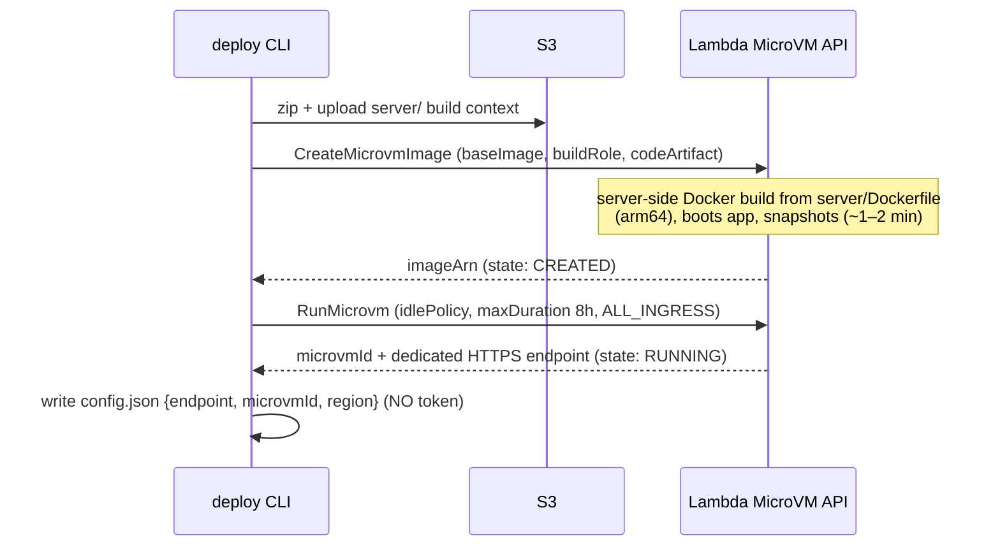
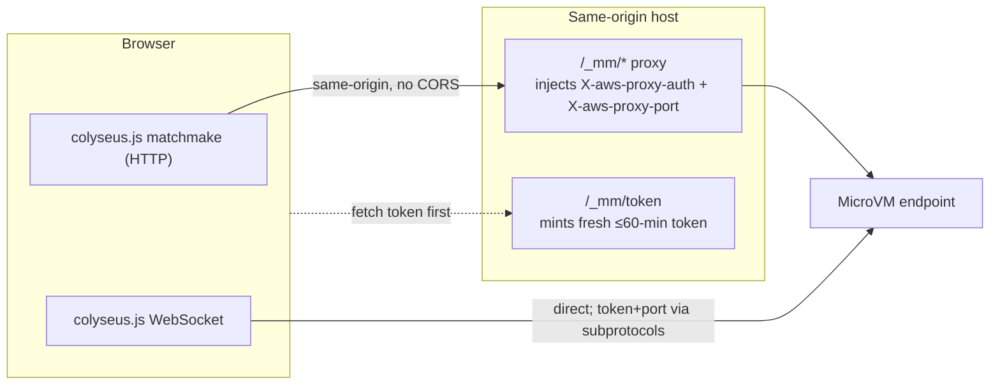

# Architecture deep-dive

How a Colyseus game server runs on a Lambda MicroVM, and the specific
connection mechanics that make a **browser** client work against it.

## Why MicroVMs for a game server

A realtime multiplayer server has three needs that classic Lambda functions
don't serve:

| Game server needs | Classic Lambda | Lambda MicroVMs |
|---|---|---|
| Long-lived WebSocket connections | request/response only | ✅ inbound endpoint natively supports WebSockets |
| A resident process holding room state in memory | stateless, ≤15 min | ✅ resident up to 8 h, memory/disk/process preserved |
| Server-driven tick broadcasts | passively triggered | ✅ the process just runs |
| Don't pay while idle | n/a | ✅ idle → auto-suspend (snapshot), traffic → auto-resume |
| Isolation per game | n/a | ✅ each instance is its own Firecracker VM |
| No self-managed load balancer | n/a | ✅ each instance gets a dedicated HTTPS endpoint |

MicroVM specs relevant here: ARM64 only; up to 16 vCPU / 32 GB / 32 GB disk;
8-hour max instance lifetime; per-instance HTTPS endpoint supporting HTTP/1.1,
HTTP/2, **WebSockets**, gRPC and SSE.

## The deploy flow



Implemented in [`deploy/src/microvm.ts`](../deploy/src/microvm.ts):
`ensureBuildRole` → `uploadServerArtifact` → `CreateMicrovmImage` →
`waitImageCreated` → `RunMicrovm` → `waitMicrovmRunning`.

### Build-role gotcha

The image build role's trust principal must be **`lambda.amazonaws.com`**, not
`microvms.lambda.amazonaws.com` (the latter is rejected as an invalid service
principal). The role only needs `s3:GetObject` on the artifact bucket.

## The connection mechanism (the hard part)

Every request to a MicroVM endpoint must carry a JWE auth token in the
`X-aws-proxy-auth` header, and the target port is selected by (in priority
order): the `X-aws-proxy-port` header, a `lambda-microvms.port.{N}`
subprotocol, or the default 8080. A **browser** can't attach custom headers to
some request types, which splits the client into two legs.



### Leg 1 — matchmake over HTTP, via same-origin proxy

A browser `fetch` directly to the cross-origin MicroVM endpoint triggers a CORS
**preflight** `OPTIONS`. Preflight requests can't carry the `X-aws-proxy-auth`
header, so the endpoint 403s them. The fix: route matchmake **same-origin**
through `/_mm/*` ([`scripts/dev-static-server.mjs`](../scripts/dev-static-server.mjs)),
which injects the auth + port headers server-side. No preflight, no CORS.

On the client, the Colyseus `Client` is pointed at `/_mm` and a custom
`urlBuilder` keeps matchmake there
([`client/src/network/microvm.ts`](../client/src/network/microvm.ts)).

### Leg 2 — WebSocket, direct, token via subprotocol

A WebSocket upgrade has **no CORS preflight**, so it can go **directly** to the
MicroVM endpoint. But the browser `WebSocket` API can't set request headers —
so the token and port travel as **subprotocols**:

```js
new WebSocket(endpointUrl, [
  'lambda-microvms',
  `lambda-microvms.authentication.${token}`,
  'lambda-microvms.port.8080',
]);
```

colyseus.js doesn't know to do this, so the client **patches `window.WebSocket`
eagerly at module load** (before colyseus.js captures the native reference) and
the `urlBuilder` rewrites the WS URL from the same-origin proxy path to the
MicroVM endpoint. The patch only rewrites sockets aimed at the configured
endpoint; everything else passes through untouched.

> **Ordering matters:** `client/src/main.tsx` imports the microvm shim and calls
> `initMicrovm()` before rendering, and `client/src/network/client.ts` imports
> the shim before `colyseus.js`. If colyseus.js evaluated first it would capture
> the native `WebSocket` and the subprotocol injection would never run.

## Token lifecycle (refresh, never baked)

Tokens expire in ≤60 minutes, so baking one into the build is a foot-gun. The
deploy CLI stores only `{ endpoint, microvmId, region }` in `config.json`. At
runtime:

- the client `GET`s `/_mm/token` for a fresh `{ endpoint, token }` right before
  connecting (`Cache-Control: no-store`);
- the static server mints tokens with `CreateMicrovmAuthToken` and caches them
  per `microvmId`, refreshing ~5 minutes early so a handed-out token always has
  runway.

A restarted or long-lived MicroVM therefore never serves a stale 403.

## Error handling worth knowing

| Code | Meaning | Client action |
|---|---|---|
| `403` | token expired / port not allowed | re-mint token |
| `429` | throttled (account- or VM-level) | exponential backoff |
| `502` | app not responding, or auto-resume didn't finish within retries | reconnect |
| (drop) | suspend→resume severs active WebSockets | reconnect |

For matches longer than 60 minutes, or across a suspend/resume, the client must
re-fetch a token and reconnect. The server already acknowledges the MicroVM
lifecycle hooks (`/run /ready /validate /resume /suspend /terminate`); wiring
client reconnect to those events is the main production follow-up.
